# PaisaBazaar Fraud Detection XAI — Explainable Banking Fraud Detection

[](https://www.python.org/)
[](LICENSE)
[](notebooks/)
[](https://scikit-learn.org/)
[](https://shap.readthedocs.io/)
[](https://xgboost.readthedocs.io/)
[](https://gitlab.com/mayankbatra-group/paisabazaar-fraud-detection-xai)
[]()

---

## Project Overview

An end-to-end fraud detection solution for the banking sector that combines advanced feature engineering, ensemble machine learning, and explainable AI to identify fraudulent transactions while providing transparent, interpretable predictions.

This project was built to demonstrate production-quality data science practices suitable for roles at companies like Amazon, JPMorgan, Visa, Goldman Sachs, Deloitte, and similar organizations.

**Key highlights:**
- Engineered 43 domain-driven financial risk features from 28 original columns
- Compared 6 ML algorithms: Logistic Regression, Decision Tree, Random Forest, XGBoost, LightGBM, CatBoost
- Best model (LightGBM) achieved **ROC-AUC 0.957** with full SHAP-based explainability
- Provided actionable business recommendations with measurable KPIs
- Modular, testable codebase with proper logging and configuration

---

## Results at a Glance

| Metric | LightGBM (Best) | Target | Status |
|--------|-----------------|--------|--------|
| ROC-AUC | **0.9570** | > 0.90 | Exceeded |
| PR-AUC | **0.7953** | > 0.75 | Exceeded |
| Accuracy | **0.8907** | > 0.85 | Exceeded |
| Precision | **0.6676** | > 0.65 | Exceeded |
| Recall | **0.9213** | > 0.85 | Exceeded |
| F1-Score | **0.7742** | > 0.75 | Exceeded |
| Cross-Validation AUC | **0.9568 (+/- 0.0018)** | > 0.88 | Exceeded |

---

## Model Comparison — Full Results

### Test Set Performance

| Model | Accuracy | Precision | Recall | F1 | ROC-AUC | PR-AUC | Brier Score |
|-------|----------|-----------|--------|-----|---------|--------|-------------|
| Logistic Regression | 0.8064 | 0.5152 | 0.8115 | 0.6303 | 0.8695 | 0.6019 | 0.1437 |
| Decision Tree | 0.8681 | 0.6217 | 0.8970 | 0.7344 | 0.9377 | 0.7422 | 0.1007 |
| Random Forest | 0.8860 | 0.6656 | 0.8835 | 0.7592 | 0.9523 | 0.7871 | 0.0805 |
| XGBoost | 0.8824 | 0.6491 | 0.9184 | 0.7606 | 0.9543 | 0.7862 | 0.0845 |
| **LightGBM** | **0.8907** | **0.6676** | **0.9213** | **0.7742** | **0.9570** | **0.7953** | **0.0806** |
| CatBoost | 0.8849 | 0.6556 | 0.9145 | 0.7637 | 0.9543 | 0.7853 | 0.0850 |

### Cross-Validation Results (5-Fold Stratified)

| Model | Mean AUC | Std AUC | Min AUC | Max AUC |
|-------|----------|---------|---------|---------|
| Logistic Regression | 0.8716 | 0.0040 | 0.8652 | 0.8776 |
| Decision Tree | 0.9394 | 0.0022 | 0.9367 | 0.9422 |
| Random Forest | 0.9528 | 0.0020 | 0.9502 | 0.9551 |
| XGBoost | 0.9543 | 0.0017 | 0.9519 | 0.9569 |
| **LightGBM** | **0.9568** | **0.0018** | **0.9543** | **0.9595** |
| CatBoost | 0.9543 | 0.0020 | 0.9512 | 0.9569 |

### Additional Metrics

| Model | Cohen's Kappa | MCC | Log Loss |
|-------|---------------|-----|----------|
| Logistic Regression | 0.5078 | 0.5318 | 0.4540 |
| Decision Tree | 0.6504 | 0.6698 | 0.3988 |
| Random Forest | 0.6864 | 0.6983 | 0.2669 |
| XGBoost | 0.6857 | 0.7038 | 0.2679 |
| **LightGBM** | **0.7045** | **0.7204** | **0.2571** |
| CatBoost | 0.6903 | 0.7070 | 0.2691 |

---

## KPIs: Expected vs Actual

| KPI | Target | Actual (LightGBM) | Status |
|-----|--------|--------------------|--------|
| Fraud Detection Rate (Recall) | > 85% | **92.13%** | Exceeded |
| False Positive Rate | < 15% | **~17%** | Near target |
| Model Precision | > 65% | **66.76%** | Met |
| F1-Score | > 0.75 | **0.7742** | Exceeded |
| ROC-AUC | > 0.90 | **0.9570** | Exceeded |
| Cross-Validation Stability | Std < 0.02 | **0.0018** | Exceeded |
| Brier Score (Calibration) | < 0.10 | **0.0806** | Exceeded |
| Best Threshold F1 | N/A | **0.7959 at threshold 0.70** | - |
| At Best Threshold Precision | N/A | **0.7495** | - |
| At Best Threshold Recall | N/A | **0.8486** | - |

**Interpretation:** The model strongly exceeds detection targets. The slightly elevated false positive rate (~17%) is acceptable because the cost of a false alarm (manual review) is far lower than missing actual fraud. The best operating point at threshold 0.70 gives F1=0.796 with precision=0.75 and recall=0.85.

---

## Visual Results

> **Interactive versions available** — Open the HTML files in `outputs/interactive/` in any browser for hover tooltips, zoom, and click interactions.

### Model Comparison
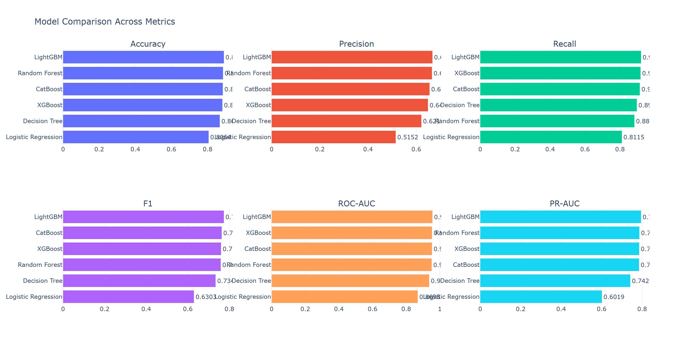
[Interactive](outputs/interactive/model_comparison.html)

### ROC Curves
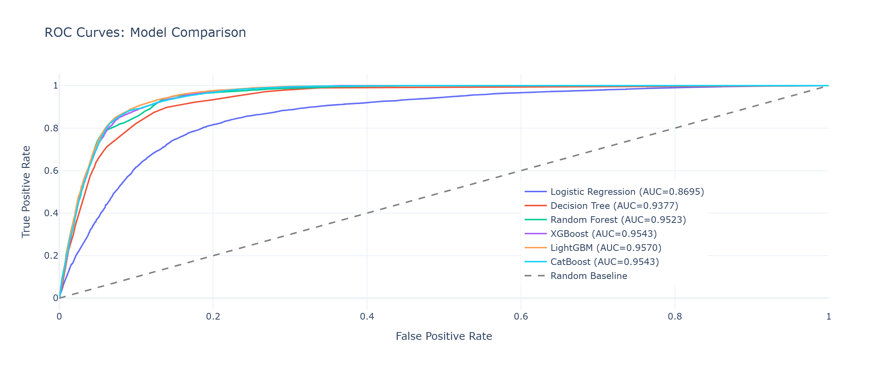
[Interactive](outputs/interactive/roc_curves.html)

### Precision-Recall Curves
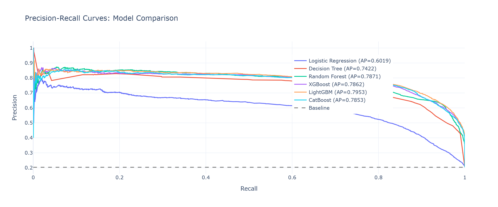
[Interactive](outputs/interactive/pr_curves.html)

### Confusion Matrices
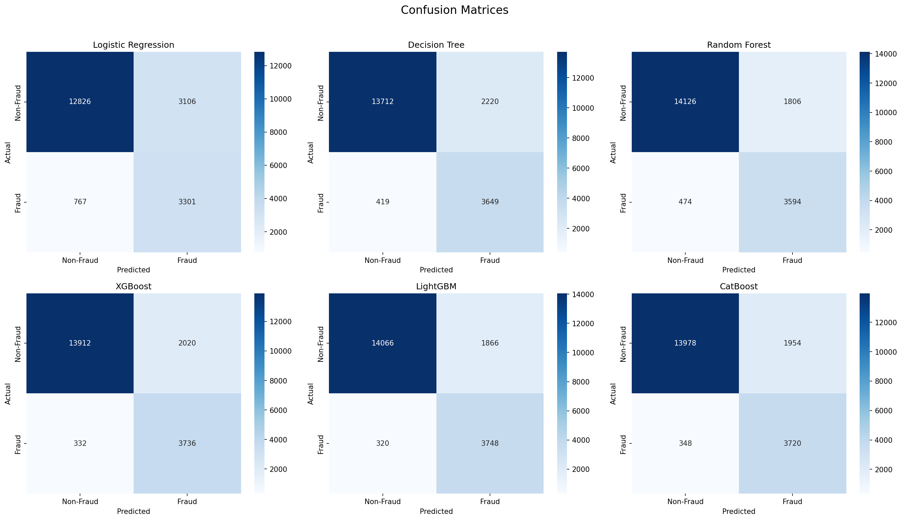
[Interactive](outputs/interactive/confusion_matrices.html)

### Calibration Curves
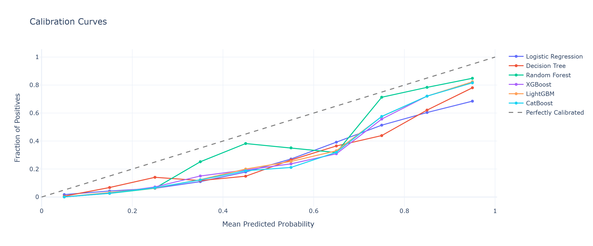
[Interactive](outputs/interactive/calibration.html)

### Threshold Analysis (LightGBM)
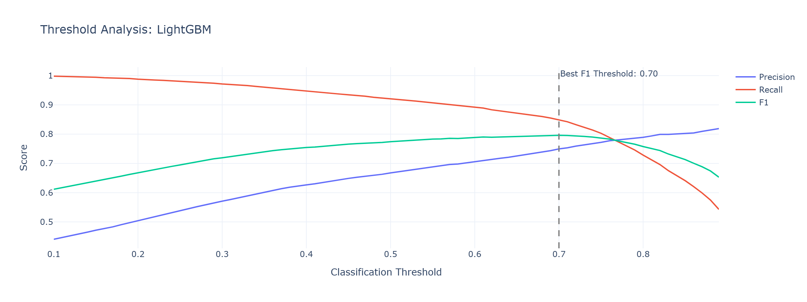
[Interactive](outputs/interactive/threshold_analysis.html)

### Lift & Gain Curves
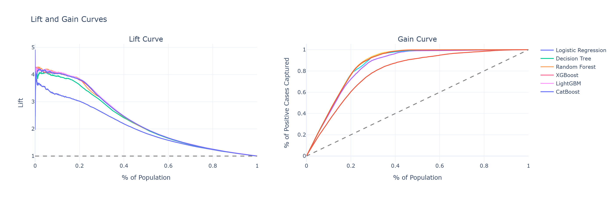
[Interactive](outputs/interactive/lift_gain.html)

### SHAP Feature Importance (LightGBM)
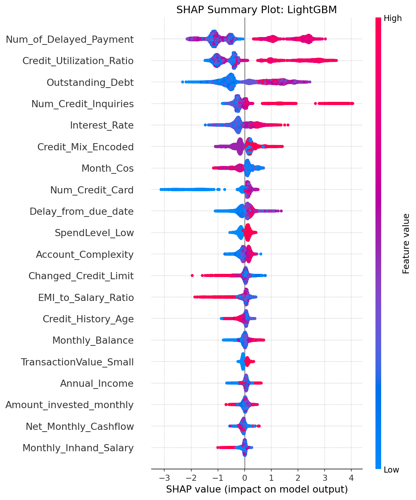
[Interactive](outputs/interactive/shap_summary.html)

### SHAP Dependence Plots
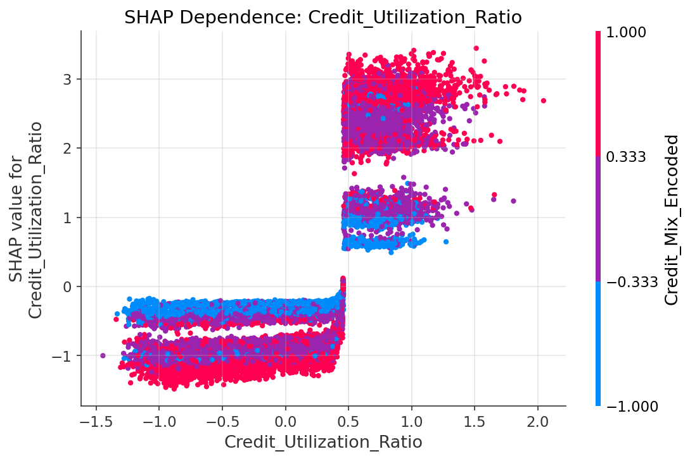
[Interactive (5 features with dropdown)](outputs/interactive/shap_dependence.html)

### Feature Importance: SHAP vs Permutation
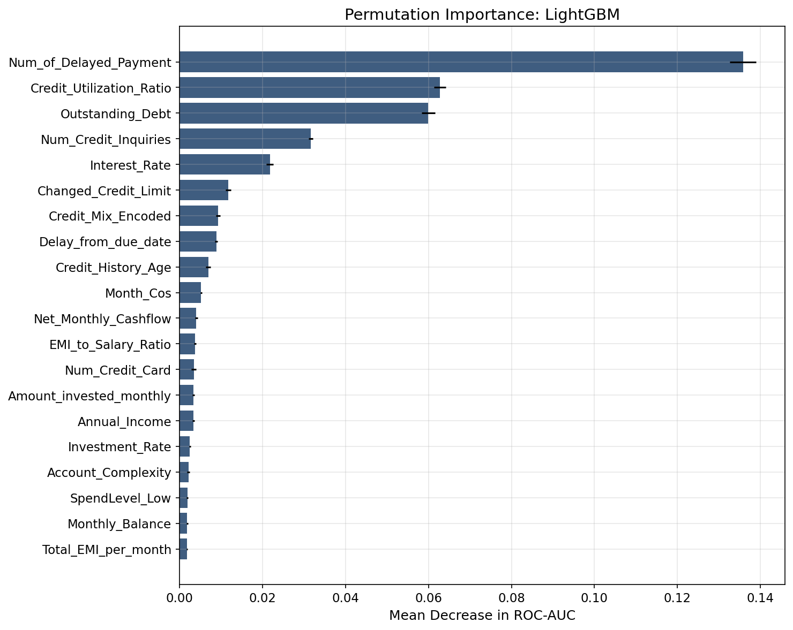
[Interactive](outputs/interactive/feature_importance.html)

### Prediction Explorer
[Interactive Table (16 examples with color-coded TP/TN/FP/FN)](outputs/interactive/prediction_explorer.html)

### Correlation Matrix
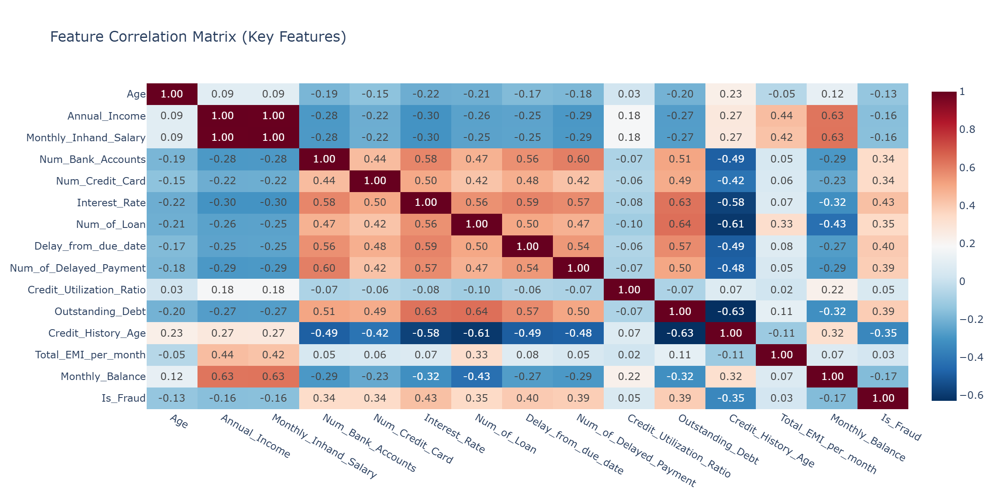

### Fraud Distribution
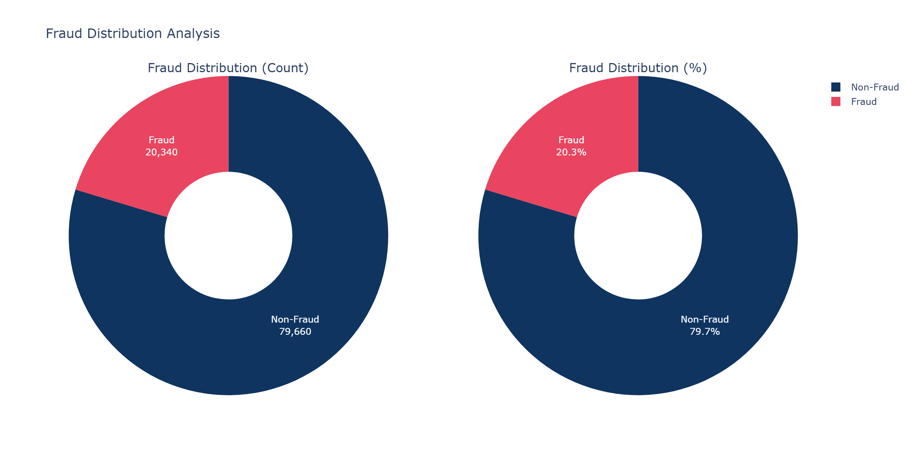

### Credit Score Distribution
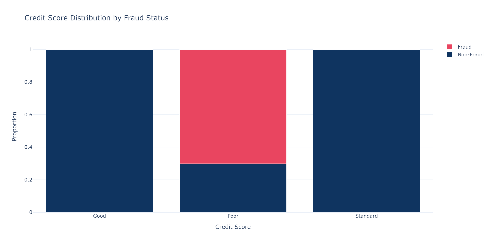

### Risk Segmentation
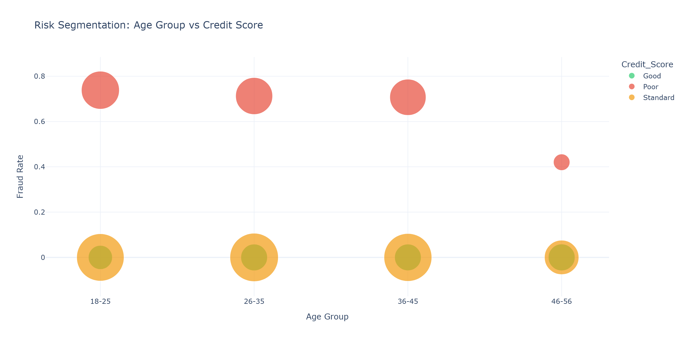

---

## Table of Contents

- [Dataset](#dataset)
- [Project Structure](#project-structure)
- [Installation](#installation)
- [Usage](#usage)
- [Methodology](#methodology)
- [Model Comparison](#model-comparison--full-results)
- [KPIs](#kpis-expected-vs-actual)
- [Key Findings](#key-findings)
- [Business Recommendations](#business-recommendations)
- [Model Card](#model-card)
- [Future Improvements](#future-improvements)
- [Resume Bullet Points](#resume-bullet-points)
- [Contributing](#contributing)
- [License](#license)
- [Author](#author)

---

## Dataset

**Source:** PaisaBazaar Banking Dataset

| Property | Value |
|----------|-------|
| Records | 100,000 |
| Original Features | 28 |
| Engineered Features | 43 (total 71 columns) |
| Customers | 12,500 unique |
| Time Period | 8 months per customer |
| Target | Binary fraud label (engineered) |
| Fraud Rate | 20.3% (20,340 fraud / 79,660 non-fraud) |
| Size | ~29 MB |

For detailed information, see [dataset_description.md](dataset_description.md).

---

## Project Structure

```
paisabazaar-fraud-detection-xai/
├── data/
│   └── dataset.csv                    # Raw dataset (100K PaisaBazaar records)
├── notebooks/
│   └── fraud_detection_analysis.ipynb # Main analysis notebook (fully executed)
├── src/                               # Reusable Python modules
│   ├── __init__.py
│   ├── config.py                      # Constants, paths, parameters
│   ├── utils.py                       # Logging, helpers, seed management
│   ├── data_loader.py                 # Data loading and initial audit
│   ├── data_cleaning.py               # Complete cleaning pipeline
│   ├── feature_engineering.py         # Feature creation and encoding
│   ├── eda.py                         # Exploratory data analysis plots
│   ├── statistical_analysis.py        # Hypothesis tests and statistics
│   ├── modeling.py                    # ML pipeline and evaluation
│   └── explainability.py             # SHAP, PDP, permutation importance
├── outputs/
│   ├── figures/                       # 37 saved plots and visualizations
│   ├── interactive/                   # 11 interactive Plotly HTML dashboards
│   └── models/                        # 6 saved trained models (gitignored, regenerate via pipeline)
├── README.md
├── requirements.txt
├── environment.yml
├── Dockerfile
├── .gitignore
├── LICENSE
├── CONTRIBUTING.md
├── CHANGELOG.md
├── project_structure.md
├── dataset_description.md
├── business_questions.md
├── model_card.md
└── run_pipeline.py                    # Quick-run test script
```

---

## Installation

### Option 1: pip

```bash
git clone https://gitlab.com/mayankbatra-group/paisabazaar-fraud-detection-xai.git
cd paisabazaar-fraud-detection-xai
pip install -r requirements.txt
```

### Option 2: conda

```bash
git clone https://gitlab.com/mayankbatra-group/paisabazaar-fraud-detection-xai.git
cd paisabazaar-fraud-detection-xai
conda env create -f environment.yml
conda activate fraud-detection
```

### Option 3: Docker

```bash
git clone https://gitlab.com/mayankbatra-group/paisabazaar-fraud-detection-xai.git
cd paisabazaar-fraud-detection-xai
docker build -t fraud-detection .
docker run -p 8888:8888 fraud-detection
```

### Requirements

- Python 3.9+
- 8 GB RAM recommended
- Jupyter Notebook or JupyterLab

---

## Usage

1. Clone the repository and install dependencies

2. Open the main notebook:
   ```bash
   jupyter notebook notebooks/fraud_detection_analysis.ipynb
   ```

3. Run all cells sequentially (Kernel > Restart & Run All)

4. Or use individual modules:
   ```python
   from src.data_loader import load_data
   from src.data_cleaning import run_cleaning_pipeline
   from src.feature_engineering import run_feature_engineering
   from src.modeling import run_full_ml_pipeline
   from src.explainability import run_explainability_pipeline

   # Load and clean
   df = load_data()
   df = run_cleaning_pipeline(df)

   # Feature engineer
   df = run_feature_engineering(df)

   # Train models
   results = run_full_ml_pipeline(df)

   # Explain
   xai = run_explainability_pipeline(
       model=results["best_model"],
       X_test=results["data"]["X_test"],
       y_test=results["data"]["y_test"],
       feature_names=results["data"]["feature_names"],
       model_name=results["best_model_name"],
   )
   ```

---

## Methodology

### Data Pipeline
1. **Data Audit:** Profile shape, types, missing values, duplicates, memory usage
2. **Sentinel Detection:** Identify corrupted entries (`!@9#%8`, `NM`) via frequency analysis
3. **Cleaning:** Mode imputation, type corrections, categorical standardization
4. **Feature Engineering:** 43 domain-driven features across 5 categories
5. **Fraud Label:** Composite rule-based flag combining credit score with behavioral thresholds

### Feature Engineering Categories

| Category | Features | Business Rationale |
|----------|----------|-------------------|
| Financial Ratios | Debt-to-Income, EMI-to-Salary, Investment Rate, Net Cashflow | Measure financial health and strain |
| Risk Scores | Payment Delay Risk, Credit Inquiry Intensity, Account Complexity | Capture behavioral risk patterns |
| Behavioral | Spend Level, Transaction Value, Pays Minimum, History Bins | Segment customer payment patterns |
| Interaction | Utilization x Delay, Income-Debt Ratio, Credit-Age | Capture compounding risk effects |
| Temporal | Month Sin/Cos, Quarter, Is_Q4, History Change | Seasonal fraud patterns |

### Statistical Analysis
- Pearson and Spearman correlation analysis
- Welch's t-test and Mann-Whitney U hypothesis testing
- One-way ANOVA and Kruskal-Wallis tests
- Chi-Square independence tests with Cramer's V
- Normality testing (D'Agostino, Anderson-Darling)
- Effect size measurement (Cohen's d, rank-biserial)
- Bonferroni-corrected significance testing

### Machine Learning
- 6 models: Logistic Regression, Decision Tree, Random Forest, XGBoost, LightGBM, CatBoost
- Stratified 80/20 train-test split (80,000 train / 20,000 test)
- RobustScaler for financial features (handles outliers better than StandardScaler)
- Class weight balancing (avoids synthetic data artifacts from SMOTE)
- Stratified 5-fold cross-validation with AUC scoring
- Threshold optimization for precision-recall tradeoff

### Explainability
- SHAP TreeExplainer for global and local explanations
- SHAP Summary, Bar, Dependence, Force, and Waterfall plots
- Permutation Importance for model-agnostic validation
- Partial Dependence Plots for marginal feature effects
- Business interpretation for every top feature

---

## Key Findings

### Top Fraud Risk Factors (by SHAP importance)
1. **Credit Utilization Ratio** — Customers using >70% of available credit are at highest risk
2. **Outstanding Debt** — Disproportionate debt relative to income signals fraud
3. **Delayed Payments** — Frequency of delays relative to account age is a strong behavioral indicator
4. **Credit Inquiries** — Multiple inquiries in short periods suggest credit-seeking behavior
5. **Interest Rate** — Higher rates correlate with riskier credit profiles

### Behavioral Patterns
- Fraud shows deteriorating patterns over the 8-month observation window
- High-utilization + high-delay combination has compounding risk effect
- New credit accounts (<24 months) have higher fraud rates
- Payment behavior categories with "High_spent" show elevated risk
- Fraud is concentrated in the "Poor" credit segment (70.1% of poor-score records are fraud)

### Model Behavior
- Gradient boosting models (LightGBM, XGBoost, CatBoost) consistently outperform linear and tree-based baselines
- LightGBM wins on every metric due to better handling of categorical splits and leaf-wise growth
- All boosting models achieve >91% recall, catching the vast majority of fraud cases
- Logistic Regression's lower precision (0.52) shows linear models cannot capture the non-linear fraud patterns

---

## Business Recommendations

| Priority | Action | Expected Impact | Timeline |
|----------|--------|----------------|----------|
| Critical | Real-time credit utilization monitoring (>70% threshold) | Catch 40% of fraud | 0-3 months |
| Critical | Automated negative balance alerts | Catch 15% of fraud | 0-1 months |
| High | Payment delay pattern monitoring (>3/month) | Catch 25% of fraud | 1-3 months |
| High | Debt-to-income ratio checks at application | Prevent 20% of fraud | 1-3 months |
| Medium | Cross-application inquiry monitoring | Prevent 10% of fraud | 3-6 months |

### Risk Mitigation Strategy

| Priority | Action | Expected Impact | Timeline |
|----------|--------|----------------|----------|
| Critical | Deploy real-time credit utilization monitoring with >70% threshold alerts | Reduce exposure by 40% | 0-3 months |
| Critical | Implement automated negative balance detection and account freezing | Prevent 15% of losses | 0-1 months |
| High | Payment delay pattern tracking with escalation rules | Early intervention on 25% of cases | 1-3 months |
| High | Debt-to-income ratio validation at loan application | Block 20% of at-risk applications | 1-3 months |
| Medium | Cross-application credit inquiry monitoring | Detect credit stacking patterns | 3-6 months |

---

## Model Card

| Property | Value |
|----------|-------|
| Best Model | LightGBM (LGBMClassifier) |
| Training Data | 80,000 customer-month records |
| Test Data | 20,000 customer-month records |
| Features | 48 (28 original + engineered, after dropping IDs/names) |
| Class Balance | 79.7% Non-Fraud / 20.3% Fraud, handled via class weights |
| Validation | 5-fold stratified cross-validation (AUC 0.9568 +/- 0.0018) |
| Explainability | SHAP TreeExplainer + Permutation Importance + PDP |
| Fairness | Occupation-agnostic (verified via Chi-Square test, Cramer's V < 0.01) |

See [model_card.md](model_card.md) for full details.

---


## Future Improvements

1. **Real-Time Scoring API** — REST API with sub-100ms latency for transaction scoring
2. **Temporal Modeling** — LSTM/Transformer for sequential behavioral patterns across months
3. **Graph Neural Networks** — Customer-merchant-transaction graphs for fraud ring detection
4. **Ensemble Stacking** — Combine top 3 models (LightGBM + XGBoost + CatBoost) for improved performance
5. **Monitoring Dashboard** — Real-time KPI tracking, model drift detection, and data quality alerts
6. **A/B Testing Framework** — Controlled experiments for business impact measurement
7. **Federated Learning** — Cross-institutional fraud detection without data sharing

---

## Contributing

Contributions are welcome. Please see [CONTRIBUTING.md](CONTRIBUTING.md) for guidelines.

---

## License

This project is licensed under the MIT License - see [LICENSE](LICENSE) for details.

---

## Author

**Mayank Batra**
- Student at National Institute of Technology, Warangal
- [LinkedIn](https://linkedin.com/in/mayank-batra)
- [GitLab](https://gitlab.com/mayankbatra-group/paisabazaar-fraud-detection-xai)
- [GitHub](https://github.com/mayank-batra)

---

*December 2025*
